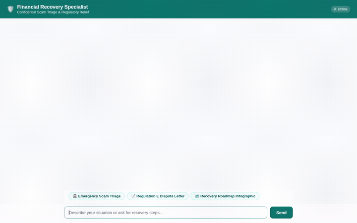

# 🛡️ Financial Recovery Specialist

An autonomous agent designed to guide financial scam and unauthorized bank transfer victims through immediate emergency triage, statutory bank dispute filing under Regulation E, regulatory fraud reporting, and long-term recovery checklists.



---

## 🌟 Overview & Core Capabilities

The **Financial Recovery Specialist** acts as a compassionate, highly structured financial social worker and fraud triage advocate. When a victim is targeted by imposter scams, wire fraud, or unauthorized account access, the agent coordinates:

- **🚨 Immediate Incident Triage**: Step-by-step guidance to halt active losses, freeze compromised debit/credit cards, and lock credit bureau files (Experian, Equifax, TransUnion).
- **⚖️ Regulation E Statutory Dispute Calculation**: Automated calculation of the 60-day consumer notice window, 10-business-day provisional credit deadlines, and 45-day investigation limits under 12 CFR § 1005.11.
- **🏛️ Verified Agency Directory (Firestore)**: Instant lookups of official reporting portals, hotlines, and complaint workflows for the FTC, FBI IC3, CFPB, FinCEN, and National Consumers League.
- **🔍 Blockchain Evidence Verification**: Live lookups on public blockchain ledgers (via public APIs) to verify wallet transactions and amounts for official law enforcement evidence packets.
- **🗺️ Milestone Infographics & Visual Guidance**: Dynamic image generation of structured recovery roadmaps and guidance animations using Gemini multimodal models.
- **🃏 Rich A2UI Displays**: Emits structured interactive cards, rows, columns, and resource badges directly in the chat interface.
- **🧠 Cross-Session Long-Term Memory**: Automatically persists case facts, compromised account types, and user preferences across conversations using Vertex AI Memory Bank.

---

## 🏗️ Architecture & Google Cloud Services

```
┌────────────────────────────────────────────────────────────────────────┐
│                        Chat Frontend & Proxy                           │
│     Vanilla JS Chat UI + A2UI Mini-Renderer <-> FastAPI A2A Proxy      │
└───────────────────────────────────┬────────────────────────────────────┘
                                    │ (A2A Protocol / Application Default Credentials)
                                    ▼
┌────────────────────────────────────────────────────────────────────────┐
│             Vertex AI Agent Runtime (Reasoning Engine)                 │
│                 Model: gemini-3.8-flash (ADK Agent)                   │
├────────────────────────────────────────────────────────────────────────┤
│  Tools & Integrations:                                                 │
│  ├─ 🧠 Long-Term Memory: Vertex AI Memory Bank (PreloadMemoryTool)      │
│  ├─ 🗄️ Database: Google Cloud Firestore (Recovery cases & directories) │
│  ├─ ⚖️ Dispute Math: Statutory Regulation E Deadline Calculator         │
│  ├─ 🌐 External API: Public Blockchain Evidence Verification (Live API)│
│  ├─ 🎨 Image Generation: gemini-3.1-flash-lite-image + Cloud Storage   │
│  ├─ 📹 Video Generation: gemini-omni-flash-preview + Cloud Storage     │
│  └─ 🎴 Display: A2UI Schema Manager (v0.8 Basic Catalog Callback)      │
└────────────────────────────────────────────────────────────────────────┘
```

### Wired Google Cloud Services & Tools
| Service / Tool | Implementation | Description |
| :--- | :--- | :--- |
| **Vertex AI Memory Bank** | `PreloadMemoryTool` & `generate_memories_callback` | Long-term memory store remembering user incident details across sessions. |
| **Google Cloud Firestore** | `app/firestore_tools.py` | Stores relief resource directories and active recovery cases. |
| **Google Cloud Storage** | `app/image_tools.py`, `app/video_tools.py` | Public bucket storing generated infographics and videos. |
| **Gemini Image Generation** | `gemini-3.1-flash-lite-image` | Generates visual recovery roadmap infographics. |
| **Gemini Omni Video Gen** | `gemini-omni-flash-preview` | Generates short guidance and security animations. |
| **A2UI Protocol** | `app/a2ui_utils.py` (v0.8) | Generates structured UI cards rendered natively in the frontend. |
| **Public Blockchain Tool** | `lookup_crypto_scam_address` | Verifies real-time crypto transaction details for evidence logs. |
| **Regulation E Tool** | `calculate_statutory_dispute_deadlines` | Computes formal bank dispute deadlines and provisional credit dates. |

> **Note on Roadmap Features**:
> - *Code Execution Sandbox*: Planned, not yet implemented.

---

## 🚀 Local Setup & Running

### Prerequisites
- Python 3.11+
- `uv` or `pip`
- Google Cloud SDK (`gcloud`) authenticated with Application Default Credentials (`gcloud auth application-default login`)

### 1. Clone & Set Up Environment
```bash
git clone <your-repo-url>
cd financial-recovery-agent
python3 -m venv .venv
source .venv/bin/activate
pip install -r requirements.txt
```

### 2. Launch Local Agent Playground
To run the ADK web development environment with the Memory Bank attached:
```bash
uv run adk web . --port 8080 --reload_agents --memory_service_uri=agentengine://<YOUR_MEMORY_BANK_ID>
```

### 3. Run the Custom Frontend & Proxy
From the `frontend/` directory:
```bash
cd frontend
pip install -r requirements.txt
export AGENT_ENGINE_RESOURCE_NAME="projects/<PROJECT_ID>/locations/<LOCATION>/reasoningEngines/<REASONING_ENGINE_ID>"
export AGENT_DIRECTORY="app"
export PORT=8080
python main.py
```
Open a browser and navigate to `localhost:8080` to access the chat interface.

---

## 🚢 Deployment

### Deploying the Agent to Agent Platform
```bash
agents-cli deploy --project <PROJECT_ID> --region us-east1
```

### Deploying the Frontend to Cloud Run
```bash
cd frontend
gcloud run deploy financial-recovery-frontend \
  --source . \
  --region us-east1 \
  --allow-unauthenticated \
  --set-env-vars "AGENT_ENGINE_RESOURCE_NAME=projects/<PROJECT_ID>/locations/us-east1/reasoningEngines/<REASONING_ENGINE_ID>,AGENT_DIRECTORY=app"
```

Ensure the Cloud Run service account has `roles/aiplatform.user` granted on the project so it can invoke the deployed agent over A2A.

---

## 📄 License
Apache License 2.0
